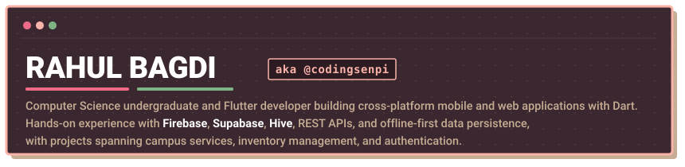
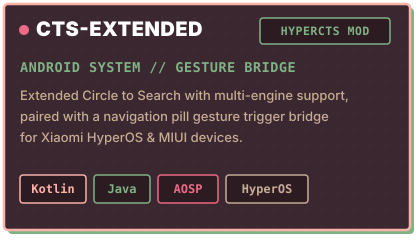
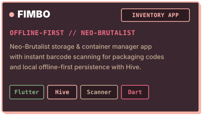
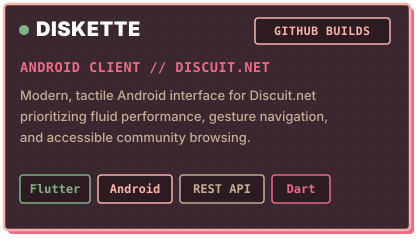
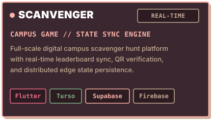
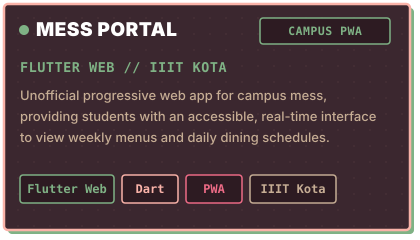
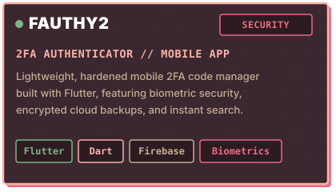

  <a href="https://rahulbagdi.dev">
    <picture>
      <source media="(max-width: 680px)" srcset="./assets/profile-header-mobile.svg" />
      
    </picture>
  </a>

<!-- Adaptive Metadata Strip (Separated from main card) -->

  
  &nbsp;
  
  &nbsp;
  

<!-- Social & Connect Bar -->

  
  &nbsp;
  
  &nbsp;
  
  &nbsp;
  

 

### `// SUMMARY & PROFILE`

Computer Science undergraduate and Flutter developer building cross-platform mobile and web applications with Dart. Hands-on experience with Firebase, Supabase, Hive, REST APIs, and offline-first data persistence, with projects spanning campus services, inventory management, and authentication.

- 💼 **Experience**:
  - **Web Team Member** &bull; **Indian Institute of Information Technology, Kota** *(Mar 2025 – Present, Remote)*
  - **Freelance Developer** &bull; **Self-Employed** *(2024 – Present, Remote)*
- 🎓 **Education**:
  - **Indian Institute of Information Technology, Kota** &bull; B.Tech in Computer Science and Engineering *(2024 – 2028 Expected)*
  - **Rawat Public School, Jaipur** &bull; Central Board of Secondary Education (CBSE) *(2009 – 2023)*

 

### `// FEATURED WORKS (KEY PROJECTS)`

  
  

  
  

  
  

 

### `// TECHNICAL SKILLS & ARSENAL`

  <strong>Languages</strong> 
  
  
  
  
  
  
  
  
  
  
  

  <strong>Frameworks</strong> 
  
  
  
  
  
  
  

  <strong>Tools, Platforms & Databases</strong> 
  
  
  
  
  
  
  
  
  
  
  
  

